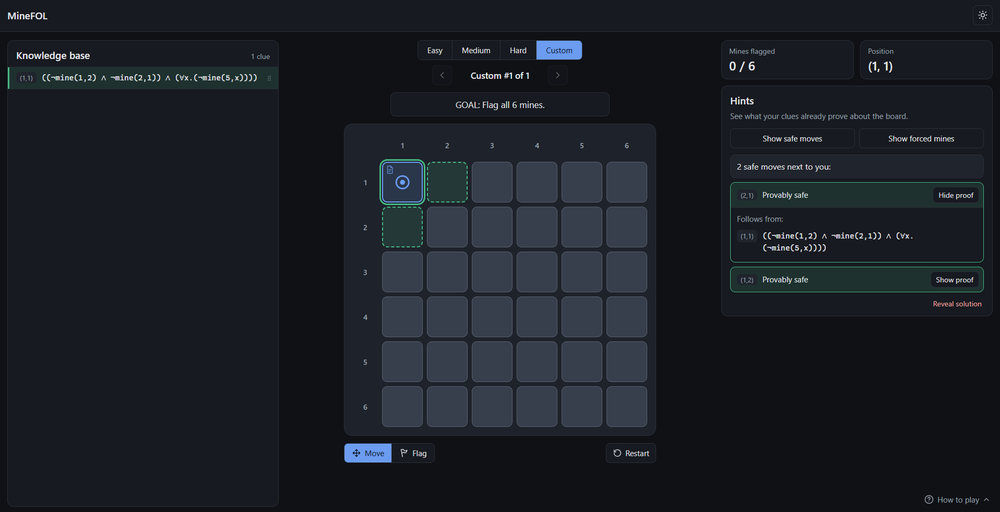
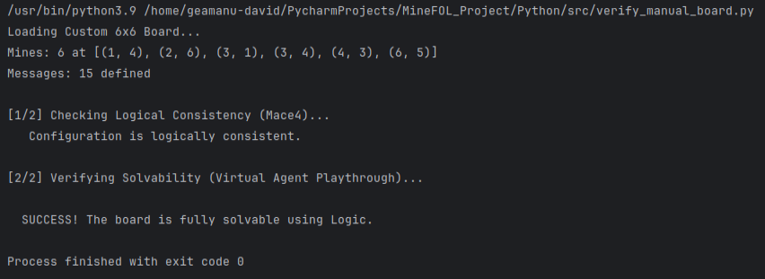

<div align="center">

# MineFOL

### A logic-based Minesweeper game powered by **First-Order Logic** and **Automated Theorem Proving**.

[](https://www.python.org/)
[](https://flask.palletsprojects.com/)
[](https://www.cs.unm.edu/~mccune/prover9/)
[](https://www.cs.unm.edu/~mccune/mace4/)
[](https://developer.mozilla.org/en-US/docs/Web/JavaScript)

*Solve Minesweeper puzzles using formal logic reasoning - clues are FOL formulas that require theorem proving to decode*

[Features](#features) •
[Tech Stack](#tech-stack) •
[Getting Started](#getting-started) •
[API Docs](#api-documentation)

</div>

---

## Table of Contents

- [Features](#features)
- [Screenshots](#screenshots)
- [Tech Stack](#tech-stack)
- [Getting Started](#getting-started)
- [How It Works](#how-it-works)
- [API Documentation](#api-documentation)
- [Project Structure](#project-structure)
- [Author](#author)
- [Acknowledgments](#acknowledgments)

---

## Features

<table>
<tr>
<td width="50%">

### FOL Clue System
- Clues about single cells, rows, columns and the diagonal
- Conjunctions, disjunctions, implications, biconditionals
- Quantified statements (`all x`, `exists x`)
- Links between cells or columns (e.g. "columns 2 and 4 have the same mines")
- No repeats: a clue that earlier clues already imply is redrawn

</td>
<td width="50%">

### Automated Reasoning
- **Mace4** for finding safe moves and forced mines
- **Prover9** for proofs explaining why a cell is safe or a mine
- Real-time theorem proving integration
- Solvability validation on generation

</td>
</tr>
<tr>
<td width="50%">

### Difficulty Levels
- **Easy** - 4×4 grid, 2–4 mines
- **Medium** - 5×5 grid, 3–5 mines
- **Hard** - 6×6 grid, 4–5 mines
- Procedurally generated, numbered puzzles (Hard #1, #2, ...); mine and clue counts vary per puzzle
- Every puzzle is checked to be solvable without guessing

</td>
<td width="50%">

### Smart Hint System
- **Show safe moves** - neighbours that are provably safe (green); currently only the orthogonal ones (up/down/left/right)
- **Show forced mines** - cells that must be mines (red)
- **Show proof** - the Prover9 proof behind a safe move or a forced mine, with the clues it used highlighted

</td>
</tr>
<tr>
<td width="50%">

### Web Interface
- Flask web app with a puzzle picker (category + ‹ #N of M ›)
- Move with clicks or WASD / arrow keys; Move/Flag toggle
- Scrollable knowledge base listing every clue found
- Light and dark themes

</td>
<td width="50%">

### Custom Puzzles
- Hand-made boards in the `custom` category
- Board validation tool (`verify_manual_board.py`)
- JSON puzzle format
- Console play mode available

</td>
</tr>
</table>

---

## Screenshots

### Flagging a Mine


### Safe Move Hint (Green Highlight)


### Forced Mine Hint (Red Highlight)


### Revealed Solution


### Manual Board Verification


---

## Tech Stack

<table>
<tr>
<td width="50%" valign="top">

### Backend
- **Python 3.x** - Core programming language
- **Flask** - Web application framework
- **gunicorn** + **Docker** - Run the app in a container
- **Prover9** - First-order logic theorem prover
- **Mace4** - Finite model finder
- **JSON** - Game state serialization

</td>
<td width="50%" valign="top">

### Frontend
- **JavaScript (ES6)** - Client-side logic
- **HTML5** - Page structure
- **CSS3** - Styling and layout
- **REST API** - Backend communication

</td>
</tr>
</table>

### Logic Systems
- **First-Order Logic (FOL)** - Formal language for clues
- **Mace4** - Searches for boards that fit the clues: finds safe cells and forced mines, and validates generated puzzles
- **Prover9** - Proves `-mine(r,c)` or `mine(r,c)` to explain why a cell is safe or a mine

---

## Getting Started

### Prerequisites

Before you begin, ensure you have the following installed:

| Tool | Version | Notes |
|------|---------|-------|
| **Linux x86-64** | glibc 2.34+ | e.g. Ubuntu 22.04 / 24.04. On Windows use [WSL](https://learn.microsoft.com/windows/wsl/install) |
| **Python** | 3.9+ | Tested with 3.12 |
| **venv** | - | On Ubuntu/Debian: `sudo apt install python3-venv` |

> **Note:** Prover9 and Mace4 are included as Linux x86-64 binaries in `bin/`. They do not run on macOS; there you would need to build [LADR](https://www.cs.unm.edu/~mccune/prover9/) (Prover9/Mace4) from source and replace the files in `bin/`.

---

### Installation

#### 1. Clone the Repository

```bash
git clone https://github.com/davidgeamanu/MineFOL.git
cd MineFOL
```

#### 2. Install Python Dependencies

Use a virtual environment. On Ubuntu 23.04+ a plain `pip install` outside one is refused ("externally-managed-environment").

```bash
python3 -m venv .venv
source .venv/bin/activate
pip install -r requirements.txt
```

#### 3. Make the Prover Binaries Executable

```bash
chmod +x bin/prover9 bin/mace4
```

---

#### 4. Run the Web Application

```bash
python Python/web/app.py
```

The app starts on **`http://localhost:5000`** (it works from any folder). Next time, only `source .venv/bin/activate` and this command are needed.

---

#### 5. Alternative: Console Mode

```bash
cd Python/src
python console_play_generated.py            # Easy #1
python console_play_generated.py hard 2     # any category and number
```

Commands: `w`/`a`/`s`/`d` to move, `h` for safe moves, `m` for forced mines, `f <row> <col>` to flag, `q` to quit.

---

#### 6. Generating Puzzles

```bash
cd Python/src
python save_game.py hard 3    # adds 3 new Hard puzzles under the next free numbers
python save_game.py           # one new puzzle per difficulty
python save_game.py medium 2 --mines 5 --clues 13   # fixed counts instead of random ones
```

Each puzzle picks its mine count and number of clue cells at random within its difficulty's range (Easy 2–4 mines / 7–9 clue cells, Medium 3–5 / 12–15, Hard 4–5 / 16–18); `--mines` and `--clues` fix them. New puzzles are validated (solvable without guessing), never overwrite existing ones, and appear in the web app after a page refresh. Easy and Medium take seconds, Hard usually a few minutes. It's safe to generate while the web app is being played: every prover call uses its own temporary folder.

---

#### 7. Alternative: Docker

Runs the app with gunicorn in a container. You only need Docker; no Python or venv on your machine.

```bash
docker compose up -d --build   # build and start in the background
docker compose logs -f         # follow the logs (Ctrl+C stops following, not the app)
docker compose down            # stop
```

The app is then on **`http://localhost`** (port 80; change the left number under `ports:` in `docker-compose.yml` to use another one). After changing code or puzzles, run the first command again.

---

## How It Works

### Game Mechanics

1. **Board Setup**: An N×N grid with hidden mines; you start on (1,1), which is always safe
2. **Movement**: Step to an adjacent cell by clicking it or with arrow keys/WASD
3. **Clue Discovery**: Some safe cells hold a clue, a true FOL formula about the mines; stepping on the cell adds it to your knowledge base
4. **Flagging**: Switch to Flag mode and click a cell. A wrong flag ends the game
5. **Win Condition**: Flag every mine without stepping on one. Every puzzle can be solved by logic alone, without guessing

### FOL Message Types

| Type | Example | Description |
|------|---------|-------------|
| Direct Fact | `mine(1,3)` | Cell (1,3) contains a mine |
| Negation | `-mine(2,4)` | Cell (2,4) is safe |
| Conjunction | `(mine(1,2) & mine(2,1))` | Both cells have mines |
| Disjunction | `(mine(1,2) \| mine(2,1))` | At least one has a mine |
| Implication | `(mine(3,4) -> -mine(2,3))` | If (3,4) is a mine, (2,3) is safe |
| Biconditional | `(mine(1,2) <-> mine(2,1))` | Both are mines or both are safe |
| Universal | `(all x -mine(5,x))` | Row 5 has no mines |
| Existential | `(exists x mine(3,x))` | Row 3 has at least one mine |
| Diagonal | `(all x -mine(x,x))` | No mines on the diagonal |
| Same columns | `(all x (mine(x,2) <-> mine(x,4)))` | Columns 2 and 4 have the same mines |
| Column link | `((exists x mine(x,2)) -> (exists x mine(x,6)))` | If column 2 has a mine, so does column 6 |
| All or none | `((all x mine(1,x)) \| (all x -mine(1,x)))` | Row 1 is all mines or all safe |

Many clues also carry a hint that leads you on, such as `(-mine(2,3) -> -mine(2,4))`: once you stand on (2,3), (2,4) is safe too.

### Theorem Prover Integration

```
Player discovers clue → added to the knowledge base
                              ↓
Player requests a hint → Mace4 checks each cell: is there any board that fits
                         the knowledge base with a mine there (or without one)?
                              ↓
Safe cells highlighted (green) / forced mines highlighted (red)
                              ↓
"Show proof" on a hint → Prover9 proves it and lists the clues it used
```

---

## API Documentation

> **Base URL:** `http://localhost:5000/api`

---

### Game Management

| Method | Endpoint | Description |
|--------|----------|-------------|
| `GET` | `/puzzles` | List puzzle categories and their numbers |
| `POST` | `/new_game` | Start puzzle #N of a category |
| `GET` | `/state` | Get current game state |
| `GET` | `/show_solution` | Reveal all mine locations |

<details>
<summary><b>POST</b> <code>/api/new_game</code> - Start a puzzle</summary>

**Request:**
```json
{
  "category": "medium",
  "number": 2
}
```

**Categories:** every folder in `build/games/` that holds numbered puzzles (`easy`, `medium`, `hard`, `custom`). `GET /api/puzzles` lists them with their numbers.

**Response** (the game state; every endpoint below returns it too):
```json
{
  "category": "medium",
  "number": 2,
  "n": 5,
  "mines": 4,
  "pos": [1, 1],
  "dead": false,
  "success": false,
  "flaggedCount": 0,
  "clues": [
    {"cell": [1, 1], "text": "((¬mine(2,1) ∧ ¬mine(1,2)) ∧ (∀x.(¬mine(3,x))))"}
  ],
  "cells": [[{"r": 1, "c": 1, "isCurrent": true, "visited": true, "flagged": false,
              "provablySafe": false, "forcedHint": false, "hasMessage": true,
              "showMessageIcon": true, "message": "((¬mine(2,1) ∧ ...)"}, "..."]]
}
```

`clues` is the knowledge base: every clue found so far, in order, with the cell it came from. `cells` is the board, row by row. `category` and `number` are only included by `/new_game` and `/state`.

</details>

---

### Player Actions

| Method | Endpoint | Description |
|--------|----------|-------------|
| `POST` | `/move` | Move to an adjacent cell |
| `POST` | `/flag` | Flag a cell as a mine |

<details>
<summary><b>POST</b> <code>/api/move</code> - Move player</summary>

**Request:**
```json
{
  "r": 1,
  "c": 2
}
```

**Response:** the updated game state (see `/new_game`), plus an `error` message for an invalid move (`"Invalid move (must move to an adjacent cell)."`) or a mine (`"You stepped on a mine at (1,4). Game over."`).

</details>

<details>
<summary><b>POST</b> <code>/api/flag</code> - Flag a cell</summary>

**Request:**
```json
{
  "r": 4,
  "c": 3
}
```

**Response:** the updated game state, plus either an `info` message (`"Flagged (4,3): forced by logic."`, or `"... it is a mine, but that was a guess."`) or an `error` for a wrong flag, which ends the game (`"(5,5) is not a mine. Game over."`).

> **Note:** Mace4 checks whether the cell is a forced mine; if not, the flag is checked against the real board.

</details>

---

### Hints

| Method | Endpoint | Description |
|--------|----------|-------------|
| `GET` | `/hint_safe` | Find provably safe moves (Mace4) |
| `GET` | `/explain_safe?r=&c=` | Explain why a cell is safe (Prover9 proof) |
| `GET` | `/hint_forced` | Find forced mines (Mace4) |
| `GET` | `/explain_mine?r=&c=` | Explain why a cell must be a mine (Prover9 proof) |

<details>
<summary><b>GET</b> <code>/api/hint_safe</code> - Get safe move hints</summary>

**Response:** the game state (with the safe cells marked `provablySafe`), plus:
```json
{
  "safeMoves": [[1, 2], [2, 1]],
  "info": "Provably safe moves: (1,2), (2,1)"
}
```

Currently only the orthogonal neighbours of your current cell (up/down/left/right) are checked. A neighbour is safe when Mace4 finds no board that fits your knowledge with a mine on it.

</details>

<details>
<summary><b>GET</b> <code>/api/explain_safe?r=1&c=3</code> - Explain a safe cell</summary>

**Response:**
```json
{
  "cell": [1, 3],
  "status": "proved",
  "facts": [
    {"kind": "clue", "cell": [1, 1], "text": "((¬mine(2,1) ∧ ¬mine(1,2)) ∧ (∀x.(¬mine(2,x))))"},
    {"kind": "clue", "cell": [1, 2], "text": "(mine(4,3) ∧ (¬mine(1,2) ⇒ ¬mine(1,3)))"}
  ],
  "usesMineCount": false,
  "mines": 3
}
```

Prover9 proves the cell is safe and lists the facts the proof used: clues (`kind: "clue"`), cells you visited (`"visited"`) and flags (`"flag"`); `usesMineCount` says whether it needed the number of mines. `status` is `"no_short_proof"` if Prover9 finds no proof within 1 s (typically steps that need counting the mines), and `"not_safe"` if the cell isn't provably safe.

</details>

<details>
<summary><b>GET</b> <code>/api/hint_forced</code> - Get forced mine hints</summary>

**Response:** the game state (with the cells marked `forcedHint`), plus:
```json
{
  "forcedMines": [[3, 4], [5, 2]],
  "info": "Forced mines: (3,4), (5,2)"
}
```

A cell is a forced mine when Mace4 finds no board that fits your knowledge with that cell safe. All unvisited, unflagged cells are checked.

</details>

<details>
<summary><b>GET</b> <code>/api/explain_mine?r=4&c=3</code> - Explain a forced mine</summary>

**Response:** the same as `/api/explain_safe`, but Prover9 proves the cell is a mine. `status` is `"not_mine"` if the cell isn't a forced mine.

</details>

---

## Project Structure

```
MineFOL/
├── bin/                          # Theorem provers (Linux x86-64 binaries)
│   ├── prover9                   # FOL theorem prover
│   └── mace4                     # Model finder
│
├── Python/
│   ├── src/                      # Core game logic
│   │   ├── game_state.py         # Game state dataclass
│   │   ├── generator.py          # Procedural game generation + solvability check
│   │   ├── message_generator.py  # FOL clue generation
│   │   ├── message_translate.py  # Formulas -> display text (¬, ∧, ∀, ...)
│   │   ├── logic_engine.py       # Prover9/Mace4 interface
│   │   ├── minefol_writer.py     # Writes Prover9/Mace4 input files
│   │   ├── runner.py             # Runs the prover binaries with a timeout
│   │   ├── parse_outputs.py      # Reads prover output
│   │   ├── grid.py               # Grid utilities
│   │   ├── console_play_generated.py  # Console player
│   │   ├── verify_manual_board.py     # Board validator
│   │   └── save_game.py          # Generates numbered puzzles
│   │
│   └── web/                      # Web interface
│       ├── app.py                # Flask server & REST API
│       ├── templates/
│       │   └── index.html        # Game UI template
│       └── static/
│           ├── app.js            # Frontend logic
│           └── style.css         # Styling
│
├── Prover/                       # Theorem prover configuration
│   └── base/                     # Base FOL axioms
│       └── minefol_base.in       # Domain axioms
│   (prover input/output files go to a temporary folder per call, deleted afterwards)
│
├── build/games/                  # Puzzle library, one folder per category
│   ├── easy/001.json … 010.json  # 4×4, 2–4 mines, easiest first
│   ├── medium/001.json … 010.json # 5×5, 3–5 mines, easiest first
│   ├── hard/001.json, ...        # 6×6, 4–5 mines
│   ├── custom/001.json           # Hand-made puzzles
│   └── mace_prover_input_files/  # Example Prover9/Mace4 input files
│   (python save_game.py hard 3 appends 3 new numbered Hard puzzles)
│
├── screenshots/                  # UI screenshots
├── Dockerfile                    # Container image (gunicorn)
├── docker-compose.yml            # Runs the container, restarts it after reboots
├── requirements.txt              # Python dependencies (Flask, gunicorn)
└── README.md
```

---

## Author

**David Geamanu**

---

## Acknowledgments

Inspired by the [Stanford Minefield Game](http://logic.stanford.edu/intrologic/extras/minefield.html).

---
