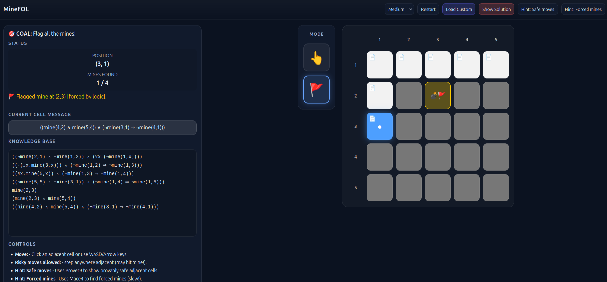
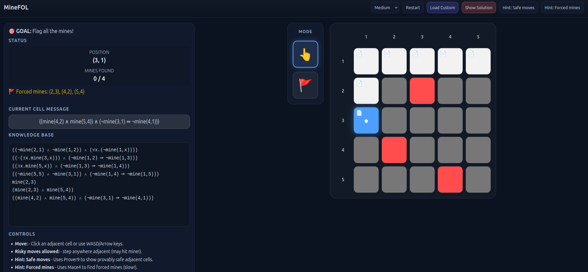
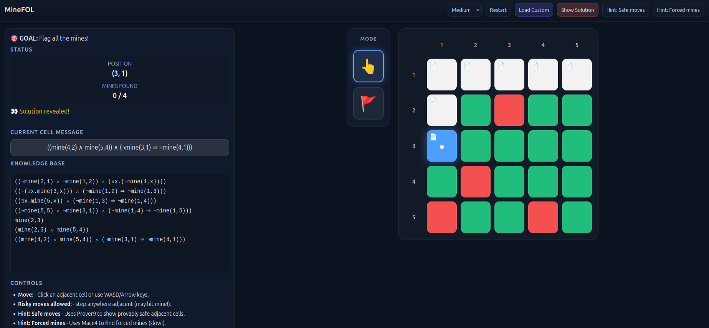

<div align="center">

# MineFOL

### A logic-based Minesweeper game powered by **First-Order Logic** and **Automated Theorem Proving**.

[](https://www.python.org/)
[](https://flask.palletsprojects.com/)
[](https://www.cs.unm.edu/~mccune/prover9/)
[](https://www.cs.unm.edu/~mccune/mace4/)
[](https://developer.mozilla.org/en-US/docs/Web/JavaScript)

*Solve Minesweeper puzzles using formal logic reasoning - clues are FOL formulas that require theorem proving to decode*

[Features](#features) •
[Tech Stack](#tech-stack) •
[Getting Started](#getting-started) •
[API Docs](#api-documentation)

</div>

---

## Table of Contents

- [Features](#features)
- [Screenshots](#screenshots)
- [Tech Stack](#tech-stack)
- [Getting Started](#getting-started)
- [How It Works](#how-it-works)
- [API Documentation](#api-documentation)
- [Project Structure](#project-structure)
- [License](#license)
- [Acknowledgments](#acknowledgments)

---

## Features

<table>
<tr>
<td width="50%">

### FOL Clue System
- **8 logical formula types** as clues
- Direct facts: `mine(r,c)` or `-mine(r,c)`
- Conjunctions, disjunctions, implications
- Biconditionals and quantified statements
- Complex nested formulas

</td>
<td width="50%">

### Automated Reasoning
- **Prover9** for proving safe moves
- **Mace4** for detecting forced mines
- Real-time theorem proving integration
- Solvability validation on generation

</td>
</tr>
<tr>
<td width="50%">

### Difficulty Levels
- **Easy** - 4×4 grid with 3 mines
- **Medium** - 5×5 grid with 4 mines
- **Hard** - 6×6 grid with 5-6 mines
- Procedurally generated puzzles

</td>
<td width="50%">

### Smart Hint System
- **Safe Move Hints** - Highlights provably safe cells (green)
- **Forced Mine Hints** - Identifies cells that must be mines (red)
- AI-powered using formal verification

</td>
</tr>
<tr>
<td width="50%">

### Web Interface
- Interactive Flask-based game UI
- Click to move, right-click to flag
- Real-time knowledge base display
- Visual feedback for all actions

</td>
<td width="50%">

### Custom Puzzles
- Load handmade puzzle boards
- Board validation tool
- JSON-based game state format
- Console play mode available

</td>
</tr>
</table>

---

## Screenshots

### Flagging a Mine


### Safe Move Hint (Green Highlight)


### Forced Mine Hint (Red Highlight)


### Revealed Solution


### Manual Board Verification


---

## Tech Stack

<table>
<tr>
<td width="50%" valign="top">

### Backend
- **Python 3.x** - Core programming language
- **Flask** - Web application framework
- **Prover9** - First-order logic theorem prover
- **Mace4** - Finite model finder
- **JSON** - Game state serialization

</td>
<td width="50%" valign="top">

### Frontend
- **JavaScript (ES6)** - Client-side logic
- **HTML5** - Page structure
- **CSS3** - Styling and layout
- **REST API** - Backend communication

</td>
</tr>
</table>

### Logic Systems
- **First-Order Logic (FOL)** - Formal language for clues
- **Prover9** - Proves `-mine(r,c)` to find safe cells
- **Mace4** - Checks model satisfiability to find forced mines

---

## Getting Started

### Prerequisites

Before you begin, ensure you have the following installed:

| Tool | Version | Download |
|------|---------|----------|
| **Python** | 3.8+ | [Download](https://www.python.org/downloads/) |
| **pip** | Latest | Included with Python |

> **Note:** Prover9 and Mace4 binaries are included in the `bin/` directory.

---

### Installation

#### 1. Clone the Repository

```bash
git clone https://github.com/yourusername/MineFOL_Project.git
cd MineFOL_Project
```

#### 2. Install Python Dependencies

```bash
pip install flask
```

#### 3. Ensure Prover Binaries are Executable

<details>
<summary><b>Linux/Mac</b></summary>

```bash
chmod +x bin/prover9
chmod +x bin/mace4
```

</details>

<details>
<summary><b>Windows</b></summary>

You may need to compile Prover9/Mace4 from source or use WSL.

</details>

---

#### 4. Run the Web Application

```bash
cd Python/web
python app.py
```

Application starts on **`http://localhost:5000`**

---

#### 5. Alternative: Console Mode

```bash
cd Python/src
python console_play_generated.py
```

---

## How It Works

### Game Mechanics

1. **Board Setup**: An N×N grid with randomly placed mines
2. **Movement**: Navigate using clicks or arrow keys/WASD
3. **Clue Discovery**: Each cell contains a FOL formula about mine locations
4. **Flagging**: Right-click to flag suspected mines
5. **Win Condition**: Flag all mines correctly without stepping on one

### FOL Message Types

| Type | Example | Description |
|------|---------|-------------|
| Direct Fact | `mine(1,3)` | Cell (1,3) contains a mine |
| Negation | `-mine(2,4)` | Cell (2,4) is safe |
| Conjunction | `(mine(1,2) & mine(2,1))` | Both cells have mines |
| Disjunction | `(mine(1,2) \| mine(2,1))` | At least one has a mine |
| Implication | `(mine(3,4) -> -mine(2,3))` | If (3,4) is a mine, (2,3) is safe |
| Biconditional | `(mine(1,2) <-> mine(2,1))` | Both are mines or both are safe |
| Universal | `(all x -mine(5,x))` | Row 5 has no mines |
| Existential | `(exists x mine(3,x))` | Row 3 has at least one mine |

### Theorem Prover Integration

```
Player discovers clue → Added to Knowledge Base →
                              ↓
Player requests hint → Prover9/Mace4 called →
                              ↓
Safe cells highlighted (green) / Forced mines highlighted (red)
```

---

## API Documentation

> **Base URL:** `http://localhost:5000/api`

---

### Game Management

| Method | Endpoint | Description |
|--------|----------|-------------|
| `POST` | `/new_game` | Start a new game |
| `POST` | `/load_custom` | Load a custom 6×6 puzzle |
| `GET` | `/state` | Get current game state |
| `GET` | `/show_solution` | Reveal all mine locations |

<details>
<summary><b>POST</b> <code>/api/new_game</code> - Start new game</summary>

**Request:**
```json
{
  "difficulty": "Medium"
}
```

**Difficulty Options:** `Easy`, `Medium`, `Hard`

**Response:**
```json
{
  "n": 5,
  "position": [1, 1],
  "visited": [[1, 1]],
  "discovered_messages": {
    "1,1": "((-mine(1,2) & -mine(2,1)) & (all x (-mine(5,x))))"
  },
  "flags": [],
  "game_over": false,
  "won": false
}
```

</details>

---

### Player Actions

| Method | Endpoint | Description |
|--------|----------|-------------|
| `POST` | `/move` | Move to an adjacent cell |
| `POST` | `/flag` | Flag/unflag a cell |

<details>
<summary><b>POST</b> <code>/api/move</code> - Move player</summary>

**Request:**
```json
{
  "row": 1,
  "col": 2
}
```

**Response:** Updated game state (see `/new_game` response format)

</details>

<details>
<summary><b>POST</b> <code>/api/flag</code> - Flag a cell</summary>

**Request:**
```json
{
  "row": 3,
  "col": 4
}
```

**Response:**
```json
{
  "success": true,
  "is_mine": true,
  "game_over": false,
  "won": false
}
```

> **Note:** Uses Mace4 to verify if the flagged cell is a forced mine.

</details>

---

### Hints

| Method | Endpoint | Description |
|--------|----------|-------------|
| `GET` | `/hint_safe` | Find provably safe moves (Prover9) |
| `GET` | `/hint_forced` | Find forced mines (Mace4) |

<details>
<summary><b>GET</b> <code>/api/hint_safe</code> - Get safe move hints</summary>

**Response:**
```json
{
  "safe_moves": [[1, 2], [2, 1]]
}
```

Cells are proven safe using Prover9 theorem proving.

</details>

<details>
<summary><b>GET</b> <code>/api/hint_forced</code> - Get forced mine hints</summary>

**Response:**
```json
{
  "forced_mines": [[3, 4], [5, 2]]
}
```

Cells identified as forced mines using Mace4 model checking.

</details>

---

## Project Structure

```
MineFOL_Project/
├── bin/                          # Compiled theorem provers
│   ├── prover9                   # FOL theorem prover
│   └── mace4                     # Model finder
│
├── Python/
│   ├── src/                      # Core game logic
│   │   ├── game_state.py         # Game state dataclass
│   │   ├── generator.py          # Procedural game generation
│   │   ├── message_generator.py  # FOL clue generation (8 types)
│   │   ├── logic_engine.py       # Prover9/Mace4 interface
│   │   ├── minefol_writer.py     # FOL instance serialization
│   │   ├── grid.py               # Grid utilities
│   │   ├── console_play_generated.py  # Console player
│   │   ├── verify_manual_board.py     # Board validator
│   │   └── save_game.py          # Save/load functionality
│   │
│   └── web/                      # Web interface
│       ├── app.py                # Flask server & REST API
│       ├── templates/
│       │   └── index.html        # Game UI template
│       └── static/
│           ├── app.js            # Frontend logic
│           └── style.css         # Styling
│
├── Prover/                       # Theorem prover configuration
│   ├── base/                     # Base FOL axioms
│   │   └── minefol_base.in       # Domain axioms
│   ├── instances/                # Generated Mace4 inputs
│   ├── queries/                  # Generated Prover9 inputs
│   └── out/                      # Prover outputs
│
├── build/games/                  # Pre-generated game instances
│   ├── game_easy.json            # 4×4, 3 mines
│   ├── game_medium.json          # 5×5, 4 mines
│   ├── game_hard.json            # 6×6, 5-6 mines
│   └── *_example.json            # Example puzzles
│
├── docs/
│   └── Documentation.pdf         # Full project documentation
│
├── screenshots/                  # UI screenshots
│
└── README.md
```

---

## Author

**David Geamanu**

---

## Acknowledgments

Inspired by the [Stanford Minefield Game](http://logic.stanford.edu/intrologic/extras/minefield.html).

---
